 

 

  

<picture>
  <source media="(prefers-color-scheme: light)" srcset="assets/titulo-stack-claro.svg"/>
  
</picture>

  

<picture>
  <source media="(prefers-color-scheme: light)" srcset="assets/titulo-projetos-claro.svg"/>
  
</picture>

  
  
  
  
  
  

 

<picture>
  <source media="(prefers-color-scheme: light)" srcset="assets/titulo-painel-claro.svg"/>
  
</picture>

<picture>
  <source media="(prefers-color-scheme: dark)" srcset="https://raw.githubusercontent.com/ArthurPr0g/ArthurPr0g/output/cobrinha-escura.svg"/>
  
</picture>

<!-- FRASE:INICIO -->

FRASE DO DIA <em>"Planilha não é sistema. Mas foi assim que todo sistema nasceu."</em>

<!-- FRASE:FIM -->

